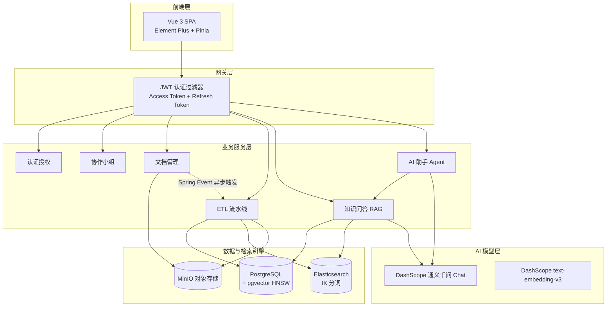

<div align="center">

**简体中文** ｜ [English](README_EN.md)

<br/>
<br/>


</div>

<br/>

<h1 align="center">CiteMind</h1>

<p align="center">
  <strong>融合 RAG 与 AI Agent 的企业级智能知识平台 · 界面可运行的全栈骨架</strong>
</p>

<p align="center">
  CiteMind = Citation（引证）+ Mind（心智）—— 让每一次提问都有据可查
</p>

<p align="center">
  <a href="#-两种运行模式">运行模式</a> ·
  <a href="#-功能全景">功能全景</a> ·
  <a href="#-快速开始">快速开始</a> ·
  <a href="#-仓库形态说明">仓库形态</a> ·
  <a href="#-项目结构">项目结构</a> ·
  <a href="#-文档导航">文档导航</a>
</p>

<br/>

---

## ✨ 这是什么？

CiteMind 是一个 **RAG（检索增强生成）知识库平台**：文档上传 → 解析切片 → 向量化 + 关键词双引擎索引 →
混合检索问答（引用溯源）→ AI Agent 多轮对话（SSE 流式 + 短期记忆），并以群组为单位做知识隔离。

本仓库的特殊之处：它是一个 **「界面可运行 + 后端留骨架」的全栈工程**——

- ✅ **前端 100% 可运行**：10 个页面全部渲染，内置 Mock 数据（登录、上传、流式问答、Agent 对话均可交互演示）；
- ✅ **后端骨架完整**：包结构、类名、接口注解、数据契约（实体/DTO/VO/枚举）全部保留，业务实现已剥离，
  每个类带有职责 Javadoc 与「骨架占位」说明；
- ✅ **文档齐全**：需求规格（含人天估算）、接口文档、数据库设计、前后端联调规范，如同一个正常迭代中的项目。

适合作为 **架构学习 / 二次开发起点 / 面试重写训练场**：照着文档和类骨架，把 RAG 链路亲手实现一遍。

## 🎭 两种运行模式

| 模式 | 启动方式 | 你能看到什么 |
|---|---|---|
| **演示模式**（默认） | 只启动前端 `npm run dev` | 全部 10 个页面 + 交互演示：任意账号登录（`admin/admin123` 为管理员）、文档上传状态流转、流式问答打字机效果、引用溯源、Agent 双模式对话、统计图表 |
| **完整模式** | 启动中间件 + 后端 + 前端（`VITE_USE_MOCK=false`） | 真实的上传/解析/检索/生成链路（后端业务实现需自行补全，见下文） |

## 🔥 功能全景

```
文档上传 → 智能解析 → 结构感知切片
    ↓
向量嵌入（pgvector HNSW, 512维） + 关键词索引（Elasticsearch IK）
    ↓
用户提问 → 查询规划（LLM） → 混合检索（RRF 融合）
    ↓
证据评估（四级充分度） → LLM 生成 → 引用溯源（拒答机制兜底）
```

| 模块 | 能力 |
|---|---|
| 🔐 认证体系 | JWT 双令牌（Access 30min + Refresh 14d httpOnly Cookie 轮换）、BCrypt、强制改密拦截 |
| 👥 协作小组 | 群组 / 三级角色 / 邀请与申请双通道审批 / 群组数据隔离 |
| 📄 文档管理 | 三阶段分片上传（秒传 / 断点续传）、多格式解析、预览下载、软删除、失败重试 |
| ⚙️ ETL 流水线 | Spring Event 异步驱动、状态机、@Retryable 重试、卡死单据恢复 Runner |
| 🔍 混合检索 | pgvector + HNSW 语义通道 ∥ Elasticsearch IK + BM25 关键词通道，RRF 融合 |
| 🧠 知识问答 | LLM 查询规划（DIRECT/REWRITE/DECOMPOSE）、四级证据评估、引用溯源、主动拒答 |
| 🤖 AI 助手 | ReactAgent 图执行引擎、CHAT/KB_SEARCH 双模式、三级短期记忆压缩、SSE 流式 |
| 📊 用量统计 | LLM 调用采集、成本折算、30 天趋势、用户/群组排行 |
| 📝 操作日志 | @OperationLog 注解 + AOP 异步落库 |

## 🚀 快速开始

### 环境要求

| 组件 | 版本 | 必需？ |
|---|---|---|
| Node.js | ≥ 20.19 | 演示模式必需 |
| JDK | 21 | 完整模式必需 |
| Docker | — | 完整模式（中间件） |

### 模式一：演示模式（零依赖，30 秒跑起来）

```bash
cd CiteMind-frontend
npm install
npm run dev
# 打开 http://localhost:5173 → 首页「登录」→ admin / admin123
```

> 登录后即可体验全部页面；使用普通账号（如 `zhang.wei`）进入业务工作区，`admin` 进入管理区。

### 模式二：完整模式（本地中间件 + 后端）

```bash
# 1) 启动中间件（PostgreSQL+pgvector / Elasticsearch / MinIO）
cd deploy && docker compose up -d

# 2) 初始化数据库
psql -h localhost -U citemind -d citemind_rag -f ../sql/schema.sql

# 3) 配置密钥
cd ../CiteMind-backend
cp .env.example .env        # 填入数据库口令与 DASHSCOPE_API_KEY

# 4) 启动后端（默认 local profile，端口 10001）
set JAVA_HOME=C:\path\to\jdk-21   # Windows 示例；Linux/macOS 用 export
./mvnw spring-boot:run
# 接口文档：http://localhost:10001/doc.html

# 5) 前端切到联调模式
cd ../CiteMind-frontend
#    .env 中设置 VITE_USE_MOCK=false
npm run dev
```

> 无中间件时后端也可直接 `./mvnw spring-boot:run` 启动（懒连接 + 降级装配），
> 用于接口骨架调试：`/doc.html` 与 Actuator 均可用。

## 📦 仓库形态说明

<details>
<summary><b>后端：类骨架保留，实现已剥离（点开了解细节）</b></summary>

- **完整保留**（可编译、可启动的契约层）：
  - 全部 **Controller / Service / Filter / Runner / Parser 的类名与职责 Javadoc**（实现类为空壳，带「骨架占位」注释）；
  - 全部 **数据契约**：实体（MyBatis-Plus 注解完整）、DTO/VO、枚举、公共 `ApiResponse`、异常体系、
    接口（ObjectStorageService、DocumentParser、LlmUsageCollector…）；
  - **MyBatis Mapper 接口与 XML**（完整 SQL 映射）、`sql/schema.sql`（18 张表 DDL）、全部 Prompt 模板；
  - 基础设施配置：主类、OpenAPI/Knife4j、配置属性类（AuthProperties / ChunkingProperties）。
- **已剥离**：各实现类的方法体、字段与依赖装配（安全过滤器链、ETL 处理器、检索适配器、Agent 工厂、记忆压缩等）。
- **验证基线**：`mvnw clean compile` 209 个源文件 BUILD SUCCESS；`mvnw spring-boot:run` 零中间件可启动。

</details>

<details>
<summary><b>前端：Mock 层与真实 API 双轨并存</b></summary>

- 页面、组件、路由、store 均为完整实现，并带有详细中文注释（文件头说明职责/数据流/接口依赖）；
- `src/api/*.ts` 保留真实后端调用；`src/mock/` 提供契约一致的演示数据与 SSE 模拟；
- 通过 `VITE_USE_MOCK` 一键切换，Mock 路由表与接口文档逐条对应。

</details>

## 🏗️ 系统架构



## 📁 项目结构

```
CiteMind/
├── CiteMind-backend/                        # Spring Boot 后端（类骨架）
│   └── src/main/java/com/citemind/rag/
│       ├── CiteMindApplication.java         #   启动主类
│       ├── auth/                            #   认证授权（JWT 双令牌）
│       ├── user/                            #   用户管理
│       ├── group/                           #   协作小组（邀请/审批/角色）
│       ├── document/                        #   文档管理（分片上传/预览/下载）
│       ├── ingestion/                       #   ETL 流水线（解析/切片/向量化/索引）
│       ├── qa/                              #   知识问答（查询规划/RRF/证据评估）
│       ├── assistant/                       #   AI 助手（ReactAgent/记忆/SSE）
│       ├── engine/                          #   引擎适配（ES/pgvector/MinIO）
│       ├── metrics/                         #   LLM 用量统计
│       └── common/                          #   ApiResponse/异常/枚举/日志切面
│   └── src/main/resources/
│       ├── application.yml + application-local.yml + application-dev.yml
│       ├── mappers/**/*.xml                 #   MyBatis XML（完整保留）
│       └── prompts/**/*.st                  #   Prompt 模板（完整保留）
│
├── CiteMind-frontend/                       # Vue 3 前端（完整可运行）
│   └── src/
│       ├── api/                             #   后端 API 封装（7 模块 + http）
│       ├── mock/                            #   内置演示数据与 SSE 模拟
│       ├── views/                           #   10 个页面 + 组件（详细注释）
│       ├── stores/ router/ layouts/ components/
│       └── types/
│
├── docs/                                    # 项目文档（见下方导航）
├── sql/schema.sql                           # 18 张表 DDL（含注释与索引）
└── deploy/docker-compose.yml                # 中间件一键编排
```

## 📖 文档导航

| 文档 | 内容 |
|---|---|
| [01-需求规格说明书](docs/01-需求规格说明书.md) | 12 个模块的需求条目、验收标准、**人天估算**（合计 ≈72 人天） |
| [02-接口文档](docs/02-接口文档.md) | 47 个接口全量定义：请求/响应示例、SSE 协议、错误语义 |
| [03-数据库设计文档](docs/03-数据库设计文档.md) | 18 张表字段/索引/约束详解 + ER 图 + 设计约定 |
| [04-前后端联调规范](docs/04-前后端联调规范.md) | 响应契约、令牌流转、SSE 协议、Mock 切换、联调 DoD |
| [docs/history/](docs/history/) | 版本演进设计文档（V1.0 → V4.1） |

## 🛠️ 技术栈

| 层 | 技术 |
|---|---|
| 后端 | Java 21 · Spring Boot 3.5 · MyBatis-Plus 3.5 · JJWT 0.12 · Spring Security Crypto · Spring Retry · Knife4j/SpringDoc |
| AI | Spring AI Alibaba 1.1（DashScope qwen-plus）· Spring AI 1.1（OpenAI 兼容 Embedding 512 维）· Agent Framework |
| 存储 | PostgreSQL 16 + pgvector（HNSW）· Elasticsearch 8（IK + BM25）· MinIO（S3 兼容） |
| 前端 | Vue 3.5 + TypeScript 6 + Vite 8 + Element Plus 2.14 + Pinia 3 + Axios + marked |
| 工程 | Maven Wrapper · Docker Compose · ESLint/OxLint/Prettier · vue-tsc |

## 🤝 如何基于这个骨架工作

1. **读文档**：从 [需求规格](docs/01-需求规格说明书.md) 选定模块 → 看对应类的 Javadoc 与「骨架占位」注释；
2. **对契约**：接口形状看 [接口文档](docs/02-接口文档.md)，表结构看 [数据库设计](docs/03-数据库设计文档.md)；
3. **动手实现**：在空壳类中补全方法体（契约类/接口/Mapper 已就位，通常无需新增文件）；
4. **联调验证**：按 [联调规范](docs/04-前后端联调规范.md) 的 DoD 自查，前端切 `VITE_USE_MOCK=false` 验证真实链路；
5. **提交**：遵循规范中的分支与提交信息约定。

## 📄 License 与致谢

本项目基于开源项目 [**Argus**](https://github.com/DevYangJC/Argus)（MIT License）的架构与前端界面重构而来：
剥离了后端业务实现、保留类骨架与全部页面，并重写/扩充了整套工程文档。感谢原作者的开源贡献。

本项目同样以 [MIT](LICENSE) 协议开源。若对完整可运行的 RAG 实现感兴趣，请前往原项目仓库。

---

<p align="center">
  <sub>CiteMind · 让每一次提问都有据可查</sub>
</p>
