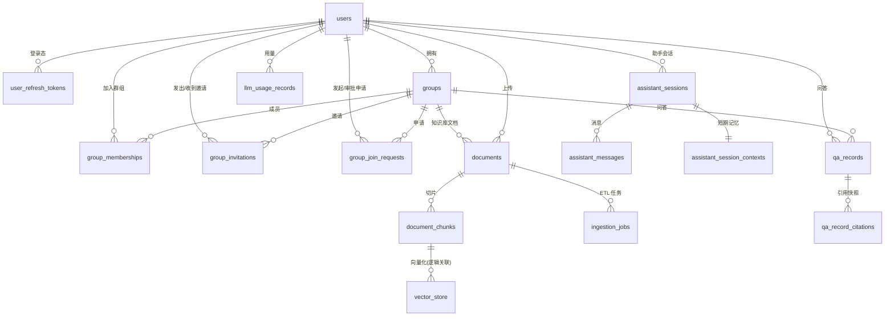

# CiteMind · 数据库设计文档

> 版本：v1.0 ｜ 数据库：PostgreSQL 16+（需 pgvector 扩展）｜ DDL：[sql/schema.sql](../sql/schema.sql)
>
> 共 **18 张表**：13 张业务表 + 1 张向量表 + 4 张 AI 会话/统计表。
> 建库流程：`CREATE EXTENSION vector;` → 执行 schema.sql → Spring AI 首次运行校验 vector_store 结构。

---

## 1. ER 总览

## 2. 表清单与模块归属

| 表 | 模块 | 说明 |
|---|---|---|
| users | 认证 / 用户管理 | 账号主表 |
| user_refresh_tokens | 认证 | Refresh Token 轮换存储 |
| groups / group_memberships | 协作小组 | 群组与成员关系 |
| group_invitations / group_join_requests | 协作小组 | 邀请与加入申请 |
| documents | 文档管理 | 文档主表（含对象存储坐标） |
| document_upload_sessions / document_upload_chunks | 文档管理 | 分片上传协议表 |
| document_chunks | ETL | 切片（检索最小单元） |
| ingestion_jobs | ETL | 异步任务状态机 |
| vector_store | 检索引擎 | pgvector 向量表 |
| assistant_sessions / assistant_messages | AI 助手 | 会话与消息 |
| assistant_session_contexts | AI 助手 | 三级短期记忆存储 |
| llm_usage_records | 用量统计 | LLM 调用明细 |
| qa_records / qa_record_citations | 知识问答 | 问答记录与引用快照 |

---

## 3. 认证与用户

### 3.1 users（用户表）

| 字段 | 类型 | 约束 | 说明 |
|---|---|---|---|
| id | BIGSERIAL | PK | 主键 |
| user_code | VARCHAR(64) | NOT NULL | 用户编码（展示用，不可修改） |
| username | VARCHAR(64) | NOT NULL, UNIQUE | 登录用户名 |
| email | VARCHAR(128) | NOT NULL, UNIQUE | 邮箱 |
| display_name | VARCHAR(128) | NOT NULL | 显示名称 |
| password_hash | VARCHAR(256) | NOT NULL | BCrypt 哈希 |
| system_role | VARCHAR(16) | NOT NULL, DEFAULT 'USER' | 系统角色：ADMIN \| USER |
| status | VARCHAR(16) | NOT NULL, DEFAULT 'ACTIVE' | 账号状态：ACTIVE \| DISABLED |
| must_change_password | BOOLEAN | NOT NULL, DEFAULT FALSE | 强制改密标记 |
| last_login_at | TIMESTAMP | — | 最后登录时间 |
| created_at / updated_at | TIMESTAMP | NOT NULL | 创建 / 更新时间 |

### 3.2 user_refresh_tokens（Refresh Token 表）

| 字段 | 类型 | 说明 |
|---|---|---|
| id | BIGSERIAL PK | 主键 |
| user_id | BIGINT FK→users | 所属用户 |
| token_id | VARCHAR(64) | token 唯一标识（UUID 去横线），**查找键** |
| token_hash | VARCHAR(256) | BCrypt 哈希后的 token（明文不落库） |
| expires_at | TIMESTAMP | 过期时间（14 天） |
| revoked_at | TIMESTAMP | 吊销时间（轮换/登出时设置，null=有效） |
| created_at | TIMESTAMP | 创建时间 |

索引：`idx_refresh_token_token_id (token_id)` 精准查找；`idx_refresh_token_user_active (user_id, revoked_at, expires_at)` 查有效会话。

> **轮换语义**：refresh 时旧记录 `revoked_at=now()` 并插入新记录；带 `revoked_at IS NULL AND expires_at > now()` 条件校验，
> 保证旧 Cookie 重放失败。

---

## 4. 协作小组

### 4.1 groups（群组表）

| 字段 | 类型 | 说明 |
|---|---|---|
| id | BIGSERIAL PK | 主键 |
| group_code | VARCHAR(64) UNIQUE | 群组编码（加入申请凭证，展示用） |
| group_name | VARCHAR(128) | 名称 |
| description | TEXT | 描述 |
| owner_user_id | BIGINT FK→users | 创建者 |
| status | VARCHAR(16) | ACTIVE \| ARCHIVED |
| created_at / updated_at | TIMESTAMP | 时间戳 |

索引：`idx_groups_owner (owner_user_id)`。

### 4.2 group_memberships（成员关系表）

| 字段 | 类型 | 说明 |
|---|---|---|
| id | BIGSERIAL PK | 主键 |
| group_id / user_id | BIGINT FK | 群组 / 用户 |
| role | VARCHAR(16) | 群内角色：OWNER \| MEMBER |
| created_at / updated_at | TIMESTAMP | 加入时间等 |

约束：`UNIQUE (group_id, user_id)`（一人一群一角色）；索引：按 user（我的群组）、按 group+role（成员校验）。

### 4.3 group_invitations（邀请表）

字段：group_id、inviter_user_id、invitee_user_id（均 FK）、status（`PENDING | ACCEPTED | REFUSED | CANCELLED`）、decided_at、时间戳。
索引：`idx_invitation_invitee_status (invitee_user_id, status)`——"我的待处理邀请"高频查询。

### 4.4 group_join_requests（加入申请表）

字段：group_id、applicant_user_id、status（`PENDING | APPROVED | REJECTED | CANCELLED`）、decided_by_user_id、decided_at、时间戳。
索引：按 `(group_id, status)` 查待审批；按 applicant 查我的申请。

---

## 5. 文档管理

### 5.1 documents（文档表）

| 字段 | 类型 | 说明 |
|---|---|---|
| id | BIGSERIAL PK | 主键 |
| group_id | BIGINT FK→groups | 所属群组（隔离边界） |
| uploader_user_id | BIGINT FK→users | 上传者 |
| file_name / file_ext / content_type | VARCHAR | 原始文件名 / 扩展名 / MIME |
| file_size | BIGINT | 字节数 |
| file_hash | VARCHAR(128) | SHA-256（秒传查重键） |
| storage_bucket / storage_object_key | VARCHAR | 对象存储坐标 |
| status | VARCHAR(16) | `UPLOADED \| PROCESSING \| READY \| FAILED` |
| deleted | BOOLEAN | 软删除标记 |
| failure_reason | TEXT | 失败原因（透出前端） |
| preview_text | TEXT | 预览文本 |
| uploaded_at / processed_at | TIMESTAMP | 上传完成 / 处理完成 |
| created_at / updated_at | TIMESTAMP | 时间戳 |

索引设计：
- `(group_id, deleted)`——列表查询主路径；
- `(group_id, file_hash) WHERE status='READY' AND deleted=FALSE`——**部分索引**，仅就绪文档参与秒传查重；
- `(status, deleted)`——失败/处理中巡检；`(uploader_user_id)`——按人筛选。

### 5.2 document_upload_sessions（上传会话表）

字段要点：`upload_id`（UUID，UNIQUE 查找键）、group_id、uploader_user_id、文件元信息、`chunk_size`、`chunk_count`、
`status`（`INIT | UPLOADING | COMPLETING | COMPLETED | EXPIRED`）、storage_bucket、merged_object_key、`expires_at`。
索引：`(group_id, uploader_user_id, file_hash, status, expires_at)`——断点续传时查找可复用会话。

### 5.3 document_upload_chunks（上传分片表）

字段要点：upload_id（FK→sessions.upload_id）、`chunk_index`、chunk_size、chunk_hash、对象存储坐标、uploaded_at。
约束：`UNIQUE (upload_id, chunk_index)`——分片幂等（重复上传同一序号报错或覆盖，实现定夺）。

---

## 6. ETL 流水线

### 6.1 document_chunks（切片表）

| 字段 | 类型 | 说明 |
|---|---|---|
| id | BIGSERIAL PK | 主键 |
| document_id | BIGINT FK→documents | 所属文档 |
| group_id | BIGINT FK→groups | 冗余群组 ID（加速过滤） |
| chunk_index | INTEGER | 文档内序号 |
| chunk_text | TEXT | 切片正文 |
| chunk_summary | TEXT | 可选摘要 |
| char_start / char_end | INTEGER | 原文定位区间（引用溯源用） |
| metadata_json | JSONB | 扩展元数据 |

### 6.2 ingestion_jobs（摄入任务表）

字段要点：document_id、group_id、job_type（INGEST_DOCUMENT）、`status`（`PENDING | RUNNING | SUCCEEDED | FAILED | CANCELLED`）、
retry_count / max_retries（默认 3）、worker_id、started_at / finished_at / `next_retry_at`、last_error。
索引：`idx_job_runnable (status, next_retry_at, created_at)`——Worker 轮询取任务的核心索引。

---

## 7. 向量存储

### 7.1 vector_store（pgvector，Spring AI 管理表结构）

| 字段 | 类型 | 说明 |
|---|---|---|
| id | VARCHAR(36) PK | UUID |
| content | TEXT | 原始文本 |
| metadata | JSONB | document_id / chunk_index / source 等 |
| embedding | **VECTOR(512)** | text-embedding-v3 嵌入向量 |

索引：HNSW（`vector_cosine_ops`，m=16，ef_construction=200）——近似最近邻检索。

> 检索时 metadata 中的 groupId 参与过滤，保证群组隔离；删除文档时按 metadata.document_id 清理对应向量。

---

## 8. AI 助手

### 8.1 assistant_sessions（会话表）

字段：user_id（FK）、title（默认"新会话"，首条消息自动重命名）、status（`ACTIVE | ARCHIVED | DELETED`）、
last_message_at（列表排序键）、时间戳。索引：`(user_id, status)`。

### 8.2 assistant_messages（消息表）

字段：session_id（FK）、role（`USER | ASSISTANT | TOOL`）、tool_mode（`CHAT | KB_SEARCH`）、
group_id（KB_SEARCH 的知识库范围）、content（Markdown）、structured_payload（JSONB，工具调用/返回结构）、created_at。
索引：`(session_id, created_at)`——上下文加载与分页。

### 8.3 assistant_session_contexts（短期记忆表，与会话 1:1）

| 字段 | 说明 |
|---|---|
| session_id | PK，FK→sessions |
| session_memory | L1：增量会话记忆摘要 |
| compact_summary | L2：紧凑摘要 |
| session_memory_base/range_end_message_id | L1 覆盖的消息区间 |
| compact_summary_base/range_end_message_id | L2 覆盖的消息区间 |
| summary_text / source_message_id | 早期消息摘要及覆盖终点 |
| context_version | **乐观锁版本号**（并发更新记忆时防覆盖） |
| updated_at | 更新时间 |

> 三级压缩策略：L1 增量摘要 → L2 紧凑压缩 → L3 运行时截断（50k token 防线，不落库）。

---

## 9. 用量统计

### 9.1 llm_usage_records（LLM 调用明细表）

| 字段 | 类型 | 说明 |
|---|---|---|
| id | BIGSERIAL PK | 主键 |
| user_id / group_id | BIGINT | 调用用户 / 关联群组（可空） |
| module | VARCHAR(32) | QA \| ASSISTANT |
| endpoint | VARCHAR(64) | qa/ask、qa/stream-ask、assistant/chat、assistant/chat/stream |
| session_id | VARCHAR(64) | 助手会话 ID（QA 可空） |
| prompt_tokens / completion_tokens / total_tokens | INT | token 三项 |
| is_estimated | BOOLEAN | 流式调用 token 是否估算 |
| cost_amount / cost_currency | DECIMAL(12,6) / VARCHAR(8) | 费用与币种（默认 CNY） |
| latency_ms | BIGINT | 响应耗时 |
| success / error_message | BOOLEAN / TEXT | 成败与原因 |
| model_name | VARCHAR(64) | 如 qwen-plus |
| created_at | TIMESTAMP | 记录时间 |

索引：`(user_id, created_at)`、`(group_id, created_at)`、`(module, created_at)`、`(created_at)`——四种统计维度各一条。

---

## 10. 知识问答

### 10.1 qa_records（问答记录表）

字段要点：user_id、group_id、question、answer（拒答可空）、answered、reason_code / reason_message（拒答原因）、
`evidence_level`（NONE/WEAK/PARTIAL/SUFFICIENT）、citation_count、token 三项 + is_estimated、latency_ms、
model_name、endpoint、success、error_message、created_at。
索引：`(user_id, created_at DESC)`、`(group_id, created_at DESC)`、`(group_id, user_id, created_at DESC)`、`(answered, created_at DESC)`。

### 10.2 qa_record_citations（引用快照表）

字段要点：qa_record_id（FK，**ON DELETE CASCADE**）、document_id / document_version_id / chunk_id / chunk_index、
start/end_chunk_index（合并证据区间）、file_name、score（最终相关性）、retrieval_source（VECTOR/KEYWORD/BOTH/HYBRID）、
vector_score / keyword_score / hybrid_score（三路得分快照）、snippet（证据文本快照）、created_at。

> 引用是**回答时刻的快照**：后续文档删除/重建索引不影响历史记录的可追溯性。

---

## 11. 设计约定

1. **枚举即 VARCHAR**：所有状态字段存枚举 `name()` 字符串（MyBatis-Plus `EnumTypeHandler`），可读性优先；
   新增枚举值只加不改，避免历史数据歧义。
2. **软删除**：documents.deleted 布尔标记；列表与检索统一带 `deleted=FALSE` 条件。
3. **审计字段**：全部业务表带 created_at / updated_at（`DEFAULT now()`，由应用层维护 updated_at）。
4. **隔离边界**：group_id 是贯穿文档、切片、向量、问答的隔离键；跨群组查询必须经服务层成员校验。
5. **JSONB 使用**：metadata_json（切片扩展）、structured_payload（工具结构）、vector_store.metadata——仅存读侧自解释的
   结构化数据，不做跨表 JOIN 依赖。
6. **主键策略**：BIGSERIAL 自增；对外暴露的业务标识（upload_id、token_id、vector id）用 UUID，避免顺序 ID 泄露规模。
